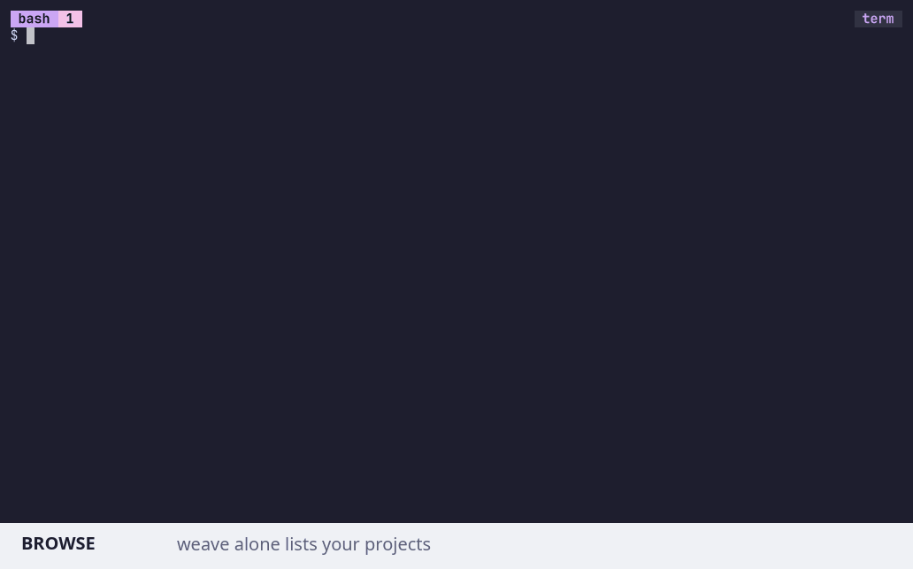
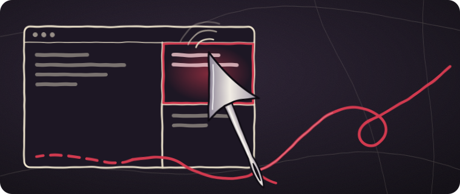

# weaver

[](https://github.com/medilies/weaver/actions/workflows/ci.yml)
[](https://github.com/medilies/weaver/releases/latest)
[](go.mod)
[](LICENSE)

Your dev environments, one command away.

weaver turns a short YAML file into a tmux session holding every
window, pane and command a project needs. `weave nimbus` builds it, or
takes you back to it, from anywhere.



- **Declare, don't script.** Windows, panes laid out in a grid,
  their directories, variables, and commands run or left typed for you.
  One file per project.
- **One command.** `weave nimbus` runs the project's setup, builds the
  session and puts you on the window you focus. Run it again and it
  takes you back, putting back the windows you closed.
- **See before you open.** `weave` alone browses your projects, drawing
  each window as it will open and warning about a missing directory or
  program.
- **Point and click.** Every action in the browser is a click away. See
  [below](#point-and-click).
- **Watch what runs.** A running session shows live in the browser, and
  a command that exited is one key from running again.
- **Tasks at hand.** Migrations, seeds, tests: commands a pane offers,
  run from the browser without leaving it.
- **Edit without YAML.** A full-screen config form: split, resize and
  remove panes on the drawing with tmux's keys, undo, and see the diff
  before saving.
- **Keep what you built.** `weave bind` turns a session you set up by
  hand into a config.
- **Nothing hidden.** weaver runs only what your config says: it knows
  no git, clones nothing and creates no directories.

## Point and click



Keep a hand on the mouse:

- **In the browser**, click a project, a window, a pane or a task. Every
  key shown at the bottom is a button too: open, start, edit, kill. See
  [the browser's keys](docs/browser.md#keys).
- **In the config form**, click a window, a pane, `+ window`, or how a
  pane starts.
- **In the session**, with tmux's `mouse on` (see
  [tmux for weaver](docs/tmux.md)), click a pane or a window to go there,
  drag a border to resize, and scroll back with the wheel.

## A project

One YAML file per project. The demo's:

```yaml
# ~/.config/weaver/projects/nimbus.yml
root: ~/dev/nimbus
windows:
  - name: api
    dir: api
    grid:
      columns: [60%, 40%]
      areas:
        - [api shell, task dev]
        - [api shell, psql]
    panes:
      - name: api shell
        tasks:
          - {name: migrate, command: task migrate}
      - name: task dev
        command: task dev
      - name: psql
        dir: .
        command: nimbus psql
  - name: app
    dir: app
    grid:
      columns: [60%, 40%]
      rows: [70%, 30%]
      areas:
        - [app shell, flutter run]
        - [app shell, emulator]
    panes:
      - name: app shell
      - name: flutter run
        command: nimbus app
      - name: emulator
        dir: .
        prefill: nimbus emulator
  - name: repo
```

## Install

### Ubuntu and Debian


From weaver's apt repository, which also installs tmux:

```sh
sudo curl -fsSLo /etc/apt/keyrings/weaver.gpg https://medilies.github.io/weaver/weaver.gpg
echo "deb [signed-by=/etc/apt/keyrings/weaver.gpg] https://medilies.github.io/weaver/ ./" \
  | sudo tee /etc/apt/sources.list.d/weaver.list
sudo apt update && sudo apt install weaver
```

`sudo apt upgrade` then brings each new release.

### Linux and macOS

[](https://github.com/medilies/weaver/releases/latest)
[](https://github.com/medilies/weaver/releases/latest)

Download a binary from the
[latest release](https://github.com/medilies/weaver/releases/latest).

### From source


```sh
go install github.com/medilies/weaver/cmd/weave@latest   # puts weave in ~/go/bin
```

### tmux

weaver needs tmux, and is tested only with tmux 3.4. Other versions
may work; if one doesn't, please open an issue. New to tmux? Start with
[tmux for weaver](docs/tmux.md).

### Completion

To complete project names with Tab, load weave's completion in your
`~/.bashrc` (zsh, fish and PowerShell work too, see
`weave completion --help`):

```sh
source <(weave completion bash)
```

## Usage

```sh
weave bind            # register the project in the current directory, through the config form
weave bind scratch    # same, starting from the windows, panes and commands of the running session scratch
weave bind .          # same, from the session you're in
weave bind --root ~/dev/shop --name shop   # with another root and name
weave nimbus          # open the nimbus session, from anywhere
weave .               # same, for the project whose root holds the current directory
weave -d nimbus       # start it, or restore its windows, without attaching: you stay where you are
weave                 # browse the projects, to open, start, bind, edit, kill or delete them, or run their tasks
weave kill nimbus     # kill the session and everything running in it
weave kill            # same, for the session you're in, if weave started it
```

## Documentation

- [Project config](docs/config.md): every field, `before` commands for toolchains, grids, the schema
- [Opening, killing and binding](docs/sessions.md): `setup` and `teardown`, restoring closed windows, capturing a session
- [The browser](docs/browser.md): summary and warnings, the drawing, tasks, keys
- [The config form](docs/config-form.md): cards, editing on the drawing, keys
- [Settings](docs/settings.md): the theme and the keys
- [tmux for weaver](docs/tmux.md): a starting config, the keys you need, the demo's theme
- [Development](docs/development.md): building, testing, architecture
