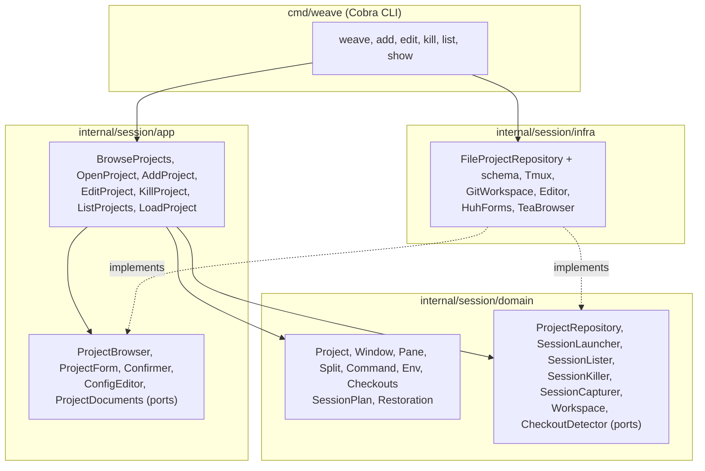

# weaver

Weaver drives tmux sessions, windows and panes from a per-project YAML
config, so starting a dev environment is one command, `weave`,
instead of a bespoke script per project.

## Install

Download a binary for Linux or macOS from the
[releases](https://github.com/medilies/weaver/releases), or build it with
Go 1.26 or newer:

```sh
go install github.com/medilies/weaver/cmd/weave@latest   # puts weave in ~/go/bin
```

## Usage

```sh
weave freeze          # register the project in the current directory, through forms
weave freeze scratch  # same, starting from the windows, panes and commands of the running session scratch
weave freeze .        # same, from the session you're in
weave bicyclette      # start or attach the bicyclette session, from anywhere
weave .               # same, for the project whose root holds the current directory
weave                 # browse the projects, to open, add, edit, kill or delete them
weave edit bicyclette # edit its config in $VISUAL or $EDITOR; only a valid config is saved
weave kill bicyclette # stop the session and everything running in it
weave list            # registered projects, and which sessions run
weave show bicyclette # print its config file
```

To complete project names with Tab, load weave's completion in your
`~/.bashrc` (zsh, fish and PowerShell work too, see
`weave completion --help`):

```sh
source <(weave completion bash)
```

`weave` alone lists the projects, a ● marking those whose session runs,
beside the selected one's config, under a summary: how many of the
configured windows a running session still has and which ones enter
restores (a session weaver didn't start is left as it is); the root,
with the branch it is on (`main* ↑2`: changes not committed, two commits
not pushed) or a warning when it is gone; which repositories are cloned;
and the `before` commands and variables every pane starts with:

| Key | Does |
| --- | --- |
| ↑ ↓ or k j | select a project |
| enter | open it, like `weave <project>` |
| a | add the current directory, like `weave freeze` |
| e | edit its config, like `weave edit <project>` |
| x | stop its session, after you confirm |
| d | delete its config, after you confirm; a running session keeps running |
| q | quit |

After adding, editing, stopping or deleting, the list comes back with
what happened.

`weave <project>` attaches to the project's tmux session (inside tmux,
it switches to it). When the session isn't running, weaver first:

1. clones the project's repositories that are missing;
2. checks every pane's directory exists;
3. builds the session, sized like your terminal so percentage splits
   come out right, labels its panes in their top border, and types each
   pane's `before` commands, then its command, into its shell.

If a step fails, nothing is left half-built. weaver needs tmux 3.2 or
newer.

When weaver started the running session and you closed some of its
windows, `weave <project>` puts them back where the config lists them
before attaching. Windows you opened yourself stay as they are, and a
session weaver didn't start is only attached.

## Development

```sh
go build ./...               # build everything
go run ./cmd/weave show X    # run without building
go test ./...                # run tests (the tmux and git adapters need tmux and git)
golangci-lint run ./...      # format check, static analysis, layer boundaries
```

The tmux adapter's tests start private tmux servers on their own
sockets; they never touch your sessions.

## Project config

A project is one config file at `~/.config/weaver/projects/<name>.yml`
(`$XDG_CONFIG_HOME/weaver/projects` when that is set). The file name is
the project's name and its tmux session's name: letters, digits, `-` and
`_`, and not one of weave's commands.

The smallest config opens one window with one shell in the root:

```yaml
root: ~/dev/weaver
```

A fuller one, with three windows:

```yaml
root: ~/dev/bicyclette
repositories:
  .: https://github.com/medilies/bicyclette.git
windows:
  - name: api
    panes:
      - name: api shell
        dir: api
      - name: task dev
        dir: api
        split: { direction: right, size: 40% }
        command: task dev
      - name: psql
        split: { direction: below }
        command: bicyclette psql
  - name: app
    panes:
      - name: app shell
        dir: app
      - name: flutter run
        dir: app
        split: { direction: right, size: 40% }
        command: bicyclette app
      - name: emulator
        split: { direction: below, size: 30% }
        prefill: bicyclette emulator
  - name: repo
```

A back end and a front end, each its own repository, on different
toolchain versions. weaver knows no toolchain: `before` types whatever
commands set one up into the pane's shell, as you would. An alias only
changes what you type: tools that run `php` themselves, such as
`composer`, need a `php` first on `PATH` instead:

```yaml
root: ~/dev/shop
repositories:
  back: git@bitbucket.org:acme/shop-back.git
  front: git@bitbucket.org:acme/shop-front.git
windows:
  - name: shop
    panes:
      - name: back
        dir: back
        before: ["alias php=php8.4"]
      - name: front
        dir: front
        split: { direction: right, size: 30% }
        before: ["nvm use 20"]
        note:
          - "Usual commands:"
          - "  npm i"
          - "  npm run dev"
```

| Field | Meaning |
| --- | --- |
| `root` | Directory the session is rooted at: absolute, or starting with `~/`. Required. |
| `repositories` | Directory (relative to `root`; `.` is `root`) → git remote. |
| `env` | Variables for every pane. Values are literal. |
| `before` | Commands typed and run in every pane, in order, before the pane's own command. They are typed as soon as the pane opens, so one that reads the terminal (`ssh`, a password prompt) takes the lines typed after it. |
| `windows` | Windows in order, with unique `name`s. None: one window named after the project. |
| `windows[].before` | Commands run in every pane of the window, after the project's `before`. |
| `windows[].panes` | Panes in creation order. None: one shell in `root`. |
| `name` (pane) | Shown in the pane's top border. Required and unique when a window has several panes. |
| `dir` | Where the pane's shell starts, relative to `root` (or absolute). |
| `split` | How every pane but the first is made: `direction` (`right` or `below`), `size` (`40%`, or `20` cells; default half of the split pane), `of` (the pane it splits; default the previous one). |
| `before` (pane) | Commands run in the pane, after its project's and window's `before`. |
| `command` | Typed into the shell and run, so it stays in the shell history. |
| `prefill` | Typed at the prompt but not run: press Enter to run it. |
| `note` | Lines printed before the shell starts. |
| `env` (pane) | Overrides the project's, per variable. |

Unknown fields are errors: they are usually typos. Comments are kept by
`weave edit`, but not when `weave freeze` replaces a config.

When weaver saves a config, it writes `weaver.schema.json` next to it
and points the config at it with a first line of
`# yaml-language-server: $schema=./weaver.schema.json`, so editors such
as VS Code (with its YAML extension) complete fields and flag mistakes
as you type.

## Architecture

The `Session` bounded context is organized by layer. `domain` imports
only the standard library, and `app` only that and `domain`, which
depguard allow-lists in `.golangci.yml` enforce. Use cases depend on ports; `infra`
implements them and `cmd/weave` wires everything together.


