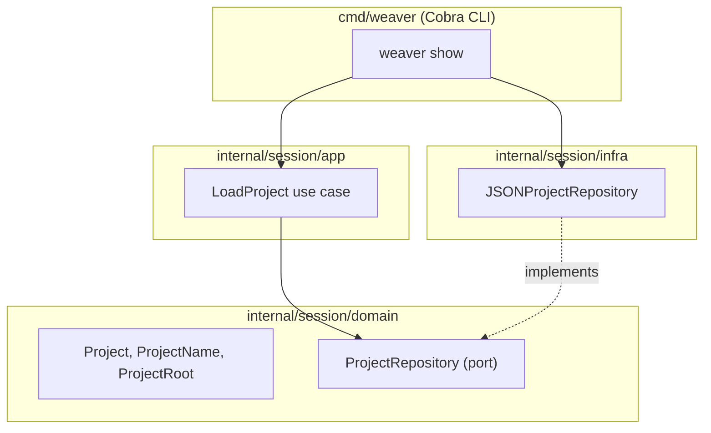

# weaver

Weaver drives tmux sessions, windows and panes from a per-project JSON
config, so starting a dev environment is one command instead of a
bespoke script per project.

## Status

Early bootstrap. `weaver show <project>` can load and print a registered
project; building the actual tmux session from a config is the next
piece of work.

## Commands

```sh
go build ./...              # build everything
go run ./cmd/weaver show X  # run without building
go test ./...                # run tests
golangci-lint run ./...      # format check, static analysis, layer boundaries
```

## Project config

A project is a JSON file at `~/.config/weaver/projects/<name>.json`:

```json
{
  "root": "/home/ilies/dev/weaver"
}
```

## Architecture

The `Session` bounded context is organized by layer. `domain` and `app`
never import Cobra or `infra` — enforced by a `depguard` rule in
`.golangci.yml`.


