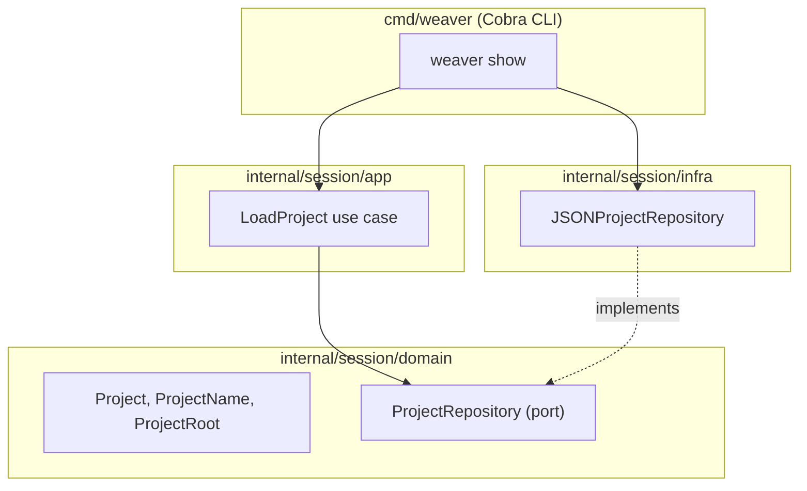

# weaver

Weaver drives tmux sessions, windows and panes from a per-project JSON
config, so starting a dev environment is one command instead of a
bespoke script per project.

## Usage

```sh
go install ./cmd/weaver   # puts weaver in ~/go/bin
weaver bicyclette         # start or attach the bicyclette session, from anywhere
weaver                    # same, for the project whose root holds the current directory
weaver kill bicyclette    # stop the session and everything running in it
weaver list               # registered projects, and which sessions run
weaver show bicyclette    # print a registered project
```

To complete project names with Tab, load weaver's completion in your
`~/.bashrc` (zsh, fish and PowerShell work too, see
`weaver completion --help`):

```sh
source <(weaver completion bash)
```

`weaver <project>` attaches to the project's tmux session (inside tmux,
it switches to it). When the session isn't running, weaver first:

1. finds every pinned PHP and Node version, and stops if one isn't
   installed;
2. clones the project's repositories that are missing;
3. checks every pane's directory exists;
4. builds the session, sized like your terminal so percentage splits
   come out right, labels its panes in their top border, and types each
   pane's command into its shell.

If a step fails, nothing is left half-built. weaver needs tmux 3.2 or
newer.

When weaver started the running session and you closed some of its
windows, `weaver <project>` puts them back where the config lists them
before attaching. Windows you opened yourself stay as they are, and a
session weaver didn't start is only attached.

Runtimes are found where Ubuntu and nvm install them: `"php": "8.4"` is
`/usr/bin/php8.4`, linked as `php` in `~/.cache/weaver/php/8.4`, and
`"node": "20"` is the newest `$NVM_DIR/versions/node/v20.*`. Either
directory goes first on the pane's PATH before its login shell starts;
nvm, sourced from `.bashrc`, keeps a Node version that is already on
PATH.

## Development

```sh
go build ./...               # build everything
go run ./cmd/weaver show X   # run without building
go test ./...                # run tests (the tmux and git adapters need tmux and git)
golangci-lint run ./...      # format check, static analysis, layer boundaries
```

The tmux adapter's tests start private tmux servers on their own
sockets; they never touch your sessions.

## Project config

A project is a JSON file at `~/.config/weaver/projects/<name>.json`
(`$XDG_CONFIG_HOME/weaver/projects` when that is set). The file name is
the project's name and its tmux session's name: letters, digits, `-` and
`_`, and not one of weaver's commands.

The smallest config opens one window with one shell in the root:

```json
{ "root": "~/dev/weaver" }
```

A fuller one, with three windows:

```json
{
  "root": "~/dev/bicyclette",
  "repositories": { ".": "https://github.com/medilies/bicyclette.git" },
  "windows": [
    { "name": "api", "panes": [
      { "name": "api shell", "dir": "api" },
      { "name": "task dev", "dir": "api", "split": { "direction": "right", "size": "40%" }, "command": "task dev" },
      { "name": "psql", "split": { "direction": "below" }, "command": "bicyclette psql" } ] },
    { "name": "app", "panes": [
      { "name": "app shell", "dir": "app" },
      { "name": "flutter run", "dir": "app", "split": { "direction": "right", "size": "40%" }, "command": "bicyclette app" },
      { "name": "emulator", "split": { "direction": "below", "size": "30%" }, "prefill": "bicyclette emulator" } ] },
    { "name": "repo" }
  ]
}
```

A back end and a front end, each its own repository, on different
toolchain versions:

```json
{
  "root": "~/dev/shop",
  "repositories": {
    "back": "git@bitbucket.org:acme/shop-back.git",
    "front": "git@bitbucket.org:acme/shop-front.git"
  },
  "windows": [
    { "name": "shop", "panes": [
      { "name": "back", "dir": "back", "runtimes": { "php": "8.4" } },
      { "name": "front", "dir": "front", "split": { "direction": "right", "size": "30%" },
        "runtimes": { "node": "20" },
        "note": ["Usual commands:", "  npm i", "  npm run dev"] } ] }
  ]
}
```

| Field | Meaning |
| --- | --- |
| `root` | Directory the session is rooted at: absolute, or starting with `~/`. Required. |
| `repositories` | Directory (relative to `root`; `.` is `root`) → git remote. |
| `env` | Variables for every pane. Values are literal. `PATH` is managed by `runtimes`. |
| `runtimes` | Versions for every pane: `php` (e.g. `8.4`) and `node` (e.g. `20`). |
| `windows` | Windows in order, with unique `name`s. None: one window named after the project. |
| `windows[].panes` | Panes in creation order. None: one shell in `root`. |
| `name` (pane) | Shown in the pane's top border. Required and unique when a window has several panes. |
| `dir` | Where the pane's shell starts, relative to `root` (or absolute). |
| `split` | How every pane but the first is made: `direction` (`right` or `below`), `size` (`40%`, or `20` cells; default half of the split pane), `of` (the pane it splits; default the previous one). |
| `command` | Typed into the shell and run, so it stays in the shell history. |
| `prefill` | Typed at the prompt but not run: press Enter to run it. |
| `note` | Lines printed before the shell starts. |
| `env`, `runtimes` (pane) | Override the project's, per key. |

Unknown fields are errors: they are usually typos.

## Architecture

The `Session` bounded context is organized by layer. `domain` and `app`
never import Cobra or `infra` — enforced by a `depguard` rule in
`.golangci.yml`.


