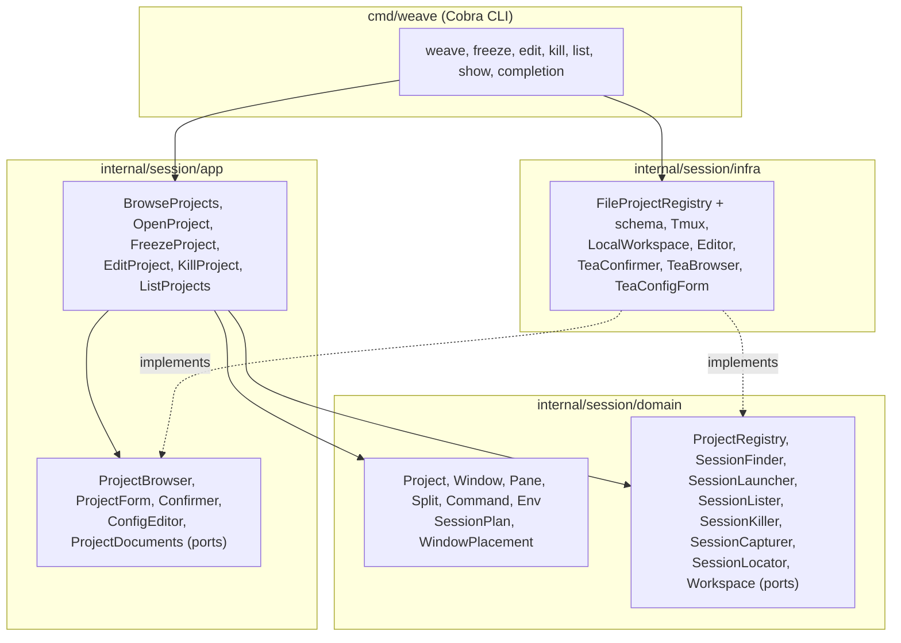

# weaver

Weaver drives tmux sessions, windows and panes from a per-project YAML
config, so starting a dev environment is one command, `weave`,
instead of a bespoke script per project.

## Install

Download a binary for Linux or macOS from the
[releases](https://github.com/medilies/weaver/releases), or build it with
Go 1.26 or newer:

```sh
go install github.com/medilies/weaver/cmd/weave@latest   # puts weave in ~/go/bin
```

weaver needs tmux, and is tested only with tmux 3.4. Other versions
may work; if one doesn't, please open an issue.

## Usage

```sh
weave freeze          # register the project in the current directory, through the config form
weave freeze scratch  # same, starting from the windows, panes and commands of the running session scratch
weave freeze .        # same, from the session you're in
weave nimbus          # open the nimbus session, from anywhere
weave .               # same, for the project whose root holds the current directory
weave                 # browse the projects, to open, freeze, edit, kill or delete them, or run their tasks
weave edit nimbus     # change its config in the config form, each field checked as you type
weave edit --raw nimbus  # edit it in $VISUAL or $EDITOR instead, keeping comments; only a valid config is saved
weave kill nimbus     # kill the session and everything running in it
weave kill            # same, for the session you're in, if weave started it
weave list            # registered projects, and which sessions run
weave show nimbus     # print its config file
```

To complete project names with Tab, load weave's completion in your
`~/.bashrc` (zsh, fish and PowerShell work too, see
`weave completion --help`):

```sh
source <(weave completion bash)
```

`weave` alone lists the projects and their roots, a ● marking those whose session runs,
beside a summary of the selected one: how many of the
configured windows a running session still has and which ones enter
restores (a session weaver didn't start is left as it is); the root, or a
warning when it is gone; what would likely fail in the panes enter
creates (a directory missing, a command whose program isn't on your `PATH`,
unchecked in panes with `before` commands or an `env` setting `PATH`,
which may provide it, aliases and shell functions showing as not found,
or a command run, `before` ones included, that leaves a quote open, so
the shell would wait for the rest of it instead of running it); in a
session weaver started, each pane whose `command` isn't running, its
shell back at its prompt: it crashed, was interrupted (Ctrl-C warns too)
or finished, or the pane is still starting, its `before` commands
included; and
the `before` commands and variables every pane starts with. Below it,
the window list names the project's windows, ○ marking those enter restores, and the
selected window is drawn as it opens: each pane a box in its
proportions, with its name when the window has several, its `dir`
unless it is the root, its `note`, and its prompt, showing a `command`
as run (`$ task dev`), a `prefill` as typed (`$ nimbus emulator█`) or
neither (`$ █`). A pane with a warning has ⚠ in its top border, and
the border is red when its directory is missing, yellow when its
program isn't found or its command exited. In a small terminal the panes are listed instead.
The selected pane is cyan, its name in brackets. Below the drawing, the
pane list names the window's panes as the drawing places them, top to
bottom then left to right, the selected one in a cyan block, and
below it are the selected pane's directory, its `before` commands in the order they
run, whether they are cleared, and its variables, each with the level it comes from (the project,
the window or the pane) and what it is over when it replaces the
window's `dir` or a project variable.

Beside the project list, the task list shows the selected project's tasks under
`window › pane`, in the order its panes are created. Running one needs the project's
session running, started by weaver: when the pane's shell is idle at its
prompt, the task's command is typed into it and run, after cutting
whatever is at the prompt, such as a `prefill` (C-y pastes it back);
when something
runs there, or the pane is in copy mode, weaver asks before running the task in a throwaway window
instead, named after the task (or its command's program), starting in
the pane's directory with its `env` and `before` commands, and kept open
once the task ends until you close it. `weave freeze` leaves throwaway
windows out, and opening the project doesn't restore them. Either way
weaver then puts you where the task runs, as opening the project does.
A pane offers tasks under `tasks:`:

```yaml
      - name: api
        dir: back
        command: php artisan serve
        tasks:
          - {name: migrate, command: php artisan migrate}
          - {command: 'php artisan db:seed'}
```

The warnings cover tasks too: a task whose program isn't on your `PATH`,
or that leaves a quote open, marks its pane.

| Key | Does |
| --- | --- |
| ↑ ↓ or k j | select a project |
| ← → | select a window to draw |
| tab or shift+tab | select the next or previous pane of the selected window, in the pane list's order |
| y | show the selected project's config, as stored, instead of its drawing, and back; it stays shown as you select other projects, and esc hides it too |
| t | move the cursor into the task list: ↑ ↓ or k j select a task, its window and pane selected in the drawing, enter runs it, esc goes back |
| click | select the project clicked in the list, the window clicked in the window list, or the pane clicked in the pane list; run the task clicked in the task list; on a key shown at the bottom, or on ← or → beside it, do what the key does; on the kept filter, edit it again as / does |
| / | filter the list by name as you type, ignoring case; while typing, ↑ ↓ select a project, ← → a window and the Tab key a pane, enter keeps the filter for the keys below and esc clears it |
| enter | open it, like `weave <project>` |
| f | freeze the current directory, like `weave freeze` |
| e | change its config in the config form, like `weave edit <project>` |
| E | edit its config in your editor, like `weave edit --raw <project>` |
| x | kill its session, after you confirm |
| d | delete its config, after you confirm; a running session keeps running |
| q or esc | quit (esc hides the config, then clears the filter, first) |

After freezing, editing, killing, deleting or running a task, the list
comes back, unfiltered, with what happened. Since the browser and the config form take
the mouse, most terminals select text with shift held, and the wheel
doesn't scroll them.

The config form shows a project as cards: the project's, then the
window list and the selected window's card. Freezing starts it on a
name, the root, and the session's windows if you named one; the name is
typed there, and stays when editing. The selected window's panes are
drawn as they open, the selected pane in cyan, heavy when the cursor is
on the drawing; below them are the pane list, then the selected pane's
card, starting with where the pane is placed. Click a window in the
window list or a pane in the pane list to select it, or a `starts`, `clear` or `focus` option
to pick it; the selected ones are cyan blocks. Each field is
checked as you type it, and a root or dir is marked ✓ when it exists; a
command run that leaves a quote open is marked ⚠, as it would leave the
shell waiting, but kept. The
project's card lists its setup and teardown commands, edited like its
before commands. A window lists the project's variables dimmed, and a
pane the project's and its window's before commands and variables, with
the level they come from; enter on such a variable sets it for the
window or pane instead. A window or pane among several has a `focus`:
whether opening lands in it, or its window selects it. A pane's tasks come last: each
its command, then its name, left blank to show the task by its command. A window
laid out by a `grid` keeps its panes' names and places.

| Key | Does |
| --- | --- |
| ↑ ↓ or k j | select a field |
| enter | type into it, or pick the next choice; on the window list or the pane list, type the window's or pane's name; on `+ add` or `+ window`, add one |
| ← → | on the window list or the pane list, select a window or a pane; on a pane's `starts`, whether it starts a shell, runs a command or prefills it, also while the command typed is empty; on `clear`, whether the `before` commands are cleared, or as the level above says; on `focus`, whether the window or pane is focused |
| o | add an item to the list selected or a task to the pane's tasks, split the pane selected right, or add a window |
| d | remove the item or task selected at once; on the pane list or a pane's other fields, remove the pane, and on a window's own fields or the window list, the window, after you confirm |
| J K | move the item, task or window selected down or up |
| u, ctrl+r | undo the last change, or redo the last change undone |
| ctrl+s | show what saving changes in the config (↑ ↓ scroll), then y, enter or ctrl+s saves and n or esc goes back; the config is rewritten, without its comments |
| esc | cancel typing, or leave, asking first when there are changes |

On the drawing, the keys are tmux's. A window laid out by a `grid` only
selects its panes there: its grid places them.

| Key | Does |
| --- | --- |
| ← → ↑ ↓ or h l k j | select the pane next to the selected one; ↑ ↓ leave the drawing at its edge |
| % or " | split the selected pane right or below, in half |
| x | remove the selected pane, after you confirm; the pane it split takes its space |
| H L | make the selected pane smaller or larger, by 5%, or by 5 cells when its size is in cells |
| enter | go to the selected pane's card |

`weave <project>` attaches to the project's tmux session (inside tmux,
it switches to it, from a `display-popup` too). When the session isn't
running, weaver first:

1. runs the config's `setup` commands in the root, one after another,
   and stops if one fails or you press Ctrl-C, starting no session;
2. checks every pane's directory exists, and stops if one is missing,
   saying to create it or change it with `weave edit`: weaver creates
   none;
3. builds the session, sized like your terminal so percentage splits
   come out right, labels its panes in their top border, and types each
   pane's `before` commands, then `clear` and its note when it clears
   them, then its command, into its shell.

weaver doesn't know git and clones nothing: clone what a project needs
yourself before opening it.

If a step fails, nothing is left half-built. What the `setup` commands
did stays done, though: with no session, there is nothing to kill, so
no `teardown` runs, and the error says so.

When weaver started the running session (an owned session) and you
closed some of its windows, `weave <project>` puts them back where the
config lists them before attaching, once it has checked their panes'
directories exist; a window that fails to build is removed again.
Windows you opened yourself stay as they are, and a session weaver
didn't start is only attached. Neither runs the `setup` commands.

`weave kill <project>` runs the config's `teardown` commands in the root
before killing an owned session, and kills it even when one fails,
reporting the failure. Anything a pane started that left it, such as
containers, keeps running unless teardown stops it.

`weave freeze <session>` starts the config form from the session as it runs:
its windows and panes, laid out as they are, each in its directory,
written relative to the root even when you reached the root through a
symlink. The command in a pane's foreground is typed at its prompt but
not run, from the directory of the shell that started it. Check it
before you run it: pipes, quotes and variables don't survive. A pane
tmux started with a command, as `tmux new-window 'npm run dev'`, gets
that command typed at its prompt too, from the directory it started in.

## Development

```sh
go build ./...               # build everything
go run ./cmd/weave show X    # run without building
go test ./...                # run tests (the tmux adapter's need tmux)
golangci-lint run ./...      # format check, static analysis, layer boundaries
```

The tmux adapter's tests start private tmux servers on their own
sockets; they never touch your sessions.

## Project config

A project is one config file at `~/.config/weaver/projects/<name>.yml`
(`$XDG_CONFIG_HOME/weaver/projects` when that is set). The file name is
the project's name and its tmux session's name: letters, digits, `-` and
`_`, starting with a letter or a digit, and not one of weave's commands.

The smallest config opens one window with one shell in the root:

```yaml
root: ~/dev/weaver
```

A fuller one, with three windows:

```yaml
root: ~/dev/nimbus
windows:
  - name: api
    dir: api
    panes:
      - name: api shell
      - name: task dev
        split: { direction: right, size: 40% }
        command: task dev
      - name: psql
        dir: .
        split: { direction: below }
        command: nimbus psql
  - name: app
    dir: app
    panes:
      - name: app shell
      - name: flutter run
        split: { direction: right, size: 40% }
        command: nimbus app
      - name: emulator
        dir: .
        split: { direction: below, size: 30% }
        prefill: nimbus emulator
  - name: repo
```

A back end and a front end on different toolchain versions. weaver
knows no toolchain: `before` types whatever commands set one up into the
pane's shell, as you would. An alias only
changes what you type: tools that run `php` themselves, such as
`composer`, need a `php` first on `PATH` instead:

```yaml
root: ~/dev/shop
windows:
  - name: shop
    panes:
      - name: back
        dir: back
        before: ["alias php=php8.4"]
      - name: front
        dir: front
        split: { direction: right, size: 30% }
        before: ["nvm use 20"]
        note:
          - "Usual commands:"
          - "  npm i"
          - "  npm run dev"
```

| Field | Meaning |
| --- | --- |
| `root` | Directory the session is rooted at: absolute, or starting with `~/`. Required. The home directory itself is `"~"`, in quotes: YAML reads a bare `~` as null. |
| `env` | Variables for every pane, and for the `setup` and `teardown` commands. Values are literal. |
| `setup` | Commands run once in `root`, in order, before `weave <project>` starts the session, such as `docker compose up -d --wait`. Each runs in its own `sh -c`, with `env` but not `before`, and its output in your terminal. A failing one stops the open, and no session is started. Not run when the session is already running. |
| `teardown` | Commands run in `root`, in order, before `weave kill` ends a session weaver started, such as `docker compose down`, run like `setup`. The session is killed even when one fails; the commands after it don't run. |
| `before` | Commands typed and run in every pane, in order, before the pane's own command. They are typed as soon as the pane opens, so one that reads the terminal (`ssh`, a password prompt) takes the lines typed after it. |
| `clear` | `true` hides the `before` commands once they ran: `clear` is typed after them, a space first so shells ignoring such lines keep it out of their history, then the `note` printed. Only the screen is cleared: tmux's scrollback keeps them. Off unless set; a window's or a pane's `clear` replaces it. |
| `windows` | Windows in order, with unique `name`s. None: one window named after the project. |
| `windows[].dir` | Where the window's panes start, unless they have their own `dir`, written like a pane's. Default: `root`. |
| `windows[].focus` | `true` lands `weave <project>` in this window when it starts the session, instead of the first. At most one window. |
| `windows[].env` | Variables for every pane of the window, over the project's, per variable. |
| `windows[].before` | Commands run in every pane of the window, after the project's `before`. |
| `windows[].clear` | Whether the window's panes clear their `before` commands, over the project's `clear`. |
| `windows[].grid` | Lays the window's panes out by naming them, instead of `split`s; see below. |
| `windows[].panes` | Panes in creation order (in any order with a `grid`). None: one shell in the window's `dir`. |
| `name` (pane) | Shown in the pane's top border. Required and unique when a window has several panes or a `grid`. |
| `focus` (pane) | `true` selects this pane in its window, instead of the first. At most one pane per window. Freezing a session focuses the window and panes that were active. |
| `dir` | Where the pane's shell starts, instead of its window's `dir`: relative to `root`, not to the window's `dir` (`.` for `root` itself), or absolute, or starting with `~/` (`"~"` in quotes for the home directory). |
| `split` | How every pane but the first is made, unless the window has a `grid`: `direction` (`right` or `below`), `size` (`40%`, or `20` cells; default half of the split pane), `of` (the name of the pane it splits; default the previous one). |
| `before` (pane) | Commands run in the pane, after its project's and window's `before`. |
| `clear` (pane) | Whether the pane clears its `before` commands, over its window's and project's `clear`. |
| `command` | Typed into the shell and run, so it stays in the shell history. |
| `prefill` | Typed at the prompt but not run: press Enter to run it. |
| `note` | Lines printed before the shell starts, or after the `before` commands when the pane clears them. |
| `env` (pane) | Overrides the window's and the project's, per variable. |
| `tasks` | Commands the pane offers to run from the browser, in a session weaver started: each a `command` and, optionally, a `name` to show instead. No two share a name, nor two unnamed ones a command. See the browser, in Usage. |

A `grid` lays a window's panes out by naming them in rows and columns,
sized as shares of the window rather than of the pane being split. This
window is the nimbus `app` window again:

```yaml
  - name: app
    dir: app
    grid:
      columns: [60%, 40%]
      rows: [70%, 30%]
      areas:
        - [app shell, flutter run]
        - [app shell, emulator]
    panes:
      - name: app shell
      - name: flutter run
        command: nimbus app
      - name: emulator
        dir: .
        prefill: nimbus emulator
```

| Field | Meaning |
| --- | --- |
| `areas` | Rows of pane names, one per column. A pane covers the rectangle of cells holding its name. Every pane is named, and none has a `split`. |
| `columns`, `rows` | One size per column or row: a percentage of the window (`60%`), or a weight sharing out what the percentages leave (`2fr`). Default: equal. |

tmux only cuts a window in straight lines, each piece cut again, so a
grid whose panes no straight line across separates is refused, such as
four panes turning around a fifth:

```text
a a b
d e b
d c c
```

`weave freeze` writes splits.

Unknown fields are errors: they are usually typos. Comments are kept by
`weave edit --raw`, but not when `weave freeze` replaces a config or the
config form saves it: weave edit asks first when a config has some.

Configs from v0.1.0 may still have `repositories:`, which weaver no
longer reads: delete it with `weave edit --raw <project>`. Saving also
refreshes `weaver.schema.json`, which until then still allows it.

When weaver saves a config, it writes `weaver.schema.json` next to it
and points the config at it with a first line of
`# yaml-language-server: $schema=./weaver.schema.json`, so editors such
as VS Code (with its YAML extension) complete fields and flag mistakes
as you type.

## Architecture

The `Session` bounded context is organized by layer. `domain` imports
only the standard library, and `app` only that and `domain`, which
depguard allow-lists in `.golangci.yml` enforce. Use cases depend on ports; `infra`
implements them and `cmd/weave` wires everything together.


