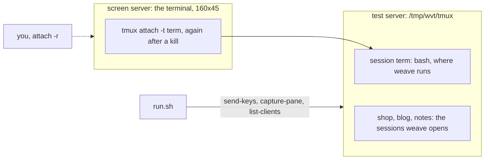

# Testing in a real terminal

How to check weave end to end before or after a release: the browser, the config form and the confirmation dialog aren't unit-tested, and neither is how they behave together in a real terminal. [`test/terminal/run.sh`](../../test/terminal/run.sh) runs every scenario below against a throwaway tmux server and prints one line per scenario, with the screen of any that fails:

```sh
test/terminal/run.sh          # all of them, about 50 seconds
test/terminal/run.sh 7 15     # some; each sets up what it needs
test/terminal/run.sh -w       # watched in a terminal window that opens for it
test/terminal/run.sh -k 11    # the servers and /tmp/wvt kept once done, to look around
```

```text
PASS 1
FAIL 2: the active pane is 'editor', not 'preview'
  | (the screen, less its blank lines)
22/23 passed, failed: 2
```

Read only that output: a passing scenario needs nothing more, and a failing one shows its screen. A failure is a bug in weave only once the scenario's keys are known to be the right ones: rerun it alone, with `-k`, and look.

## Before and after a release

Before a release, run it as above: it builds `./cmd/weave`. After one, test what users get, each binary in turn with `-b`:

```sh
mkdir -p /tmp/wvr/gobin && cd /tmp/wvr
GOBIN=/tmp/wvr/gobin go install github.com/medilies/weaver/cmd/weave@vX.Y.Z
gh release download vX.Y.Z -R medilies/weaver -p '*inux*amd64*' -p checksums.txt
sha256sum -c --ignore-missing checksums.txt
mkdir asset && tar -xzf *inux*amd64*.tar.gz -C asset
gobin/weave --version; asset/weave --version   # both vX.Y.Z
cd - && test/terminal/run.sh -b /tmp/wvr/gobin && test/terminal/run.sh -b /tmp/wvr/asset
rm -rf /tmp/wvr
```

The script checks text, sizes, colours as escape codes and what tmux holds, not how a terminal emulator draws them. Watch one run for what only eyes catch, such as misaligned borders or a wide character cut in half: `-w` opens a terminal window of 160x45 watching it, read-only, and waits for Enter once done before closing it. The window is the terminal `TERMINAL` names, else the first of kitty, alacritty, foot, gnome-terminal, xterm and x-terminal-emulator on `PATH`. Without `-w`, the run prints how to watch it from a terminal of your own; the screen it shows isn't the default tmux server's, so `tmux attach` alone finds nothing:

```sh
tmux -S /tmp/wvt/screen.sock attach -r
```

## How it runs



- **A terminal without a display.** weave attaches and switches a client, so the test server needs one. A second tmux server, `screen`, fixed at 160x45 whoever watches it, runs it in a loop that attaches again when a kill ends it.
- **The same environment on every machine.** Every tmux command runs under `env -i` with the test's `HOME`, `XDG_CONFIG_HOME`, `TMUX_TMPDIR`, locale, `TERM` and a `PATH` starting with the weave under test, from `/tmp/wvt`. This isn't only tidiness: tmux gives the panes a command creates the environment of the client sending it, so without it the shells inherit the caller's `PATH` and run their installed weave. The setup checks that `term`'s shell finds the weave under test. `term` runs bash reading no rc file. The panes weave creates run bash whatever your login shell is, with a home of their own whose `.bashrc` gives a plain prompt, and no login banner.
- **Linux.** GNU tools, the `C.UTF-8` locale and tmux's `tmux-256color` terminfo.
- **Each scenario starts fresh.** No session but `term`, the others killed once unzoomed, as tmux 3.4 needs, a new shell in it, the client on it at full size, the sample projects as written and no settings. One failure doesn't take the next scenarios with it, and any one runs alone.
- **Waiting for what must show, never for a time.** Every check polls, ten times a second up to a few seconds, for a text on the screen, a client's session, a pane's running command or a file. Keys sent together are safe, as Bubble Tea reads them in order; only a program just started needs waiting for, until its key line shows. A screen being redrawn, after a resize, can match half-made: check what must and must not show on one capture.

## Never touch the user's tmux

The agent's shell usually runs inside the user's tmux, with `$TMUX` set, and `tmux` then talks to the user's server whatever `TMUX_TMPDIR` says. The script unsets `TMUX` and names its socket in every tmux command, through `T` and `S`. Driving it by hand, do the same:

- Start every command with `unset TMUX`, and never run a bare `tmux`.
- Before relying on an empty variable, such as a pane ID read with `awk`, check it: `send-keys -t ""` goes to whatever tmux picks.

To try a new case before writing its scenario, keep a run with `-k` and source the script, which then defines its functions without running anything:

```sh
test/terminal/run.sh -k 1
unset TMUX; . test/terminal/run.sh
fresh; started shop; logs_idle; browse shop; keys Right; wait_for 'r rerun' && screen | grep -F '⚠'
```

Read with `grep` or `wait_for`, not whole screens. `clean` removes the servers and `/tmp/wvt`, and the next run does it anyway.

## Scenarios

Each is a function `sN` in the script, starting fresh. *Started* means started with `weave <project> --detached` from `term`; *select* means with the filter; *edit* means `e` on the project, selected in `weave`.

| # | Do | Expect |
| --- | --- | --- |
| 1 | `weave` | The project list, task list, details (`blog.yml`) and key line drawn. |
| 2 | `weave`, select `blog`, Enter | The client switches to `blog`, `preview`, focused, is the active pane, and the grid is 60/40 and 70/30 of the window: `editor` 95x43, `preview` 64x29, `shell` 64x13. |
| 3 | `weave shop` | The setup command's output shows in `term`. The client lands in window `api`, pane `back`, both focused. `echo "$APP_ENV $LOG"` prints `staging info` in `logs` and `dev info` in `back`. |
| 4 | `shop` started, its `sleep 3` exited: `weave`, select `shop`, → | `⚠` on `logs`. The levels show `APP_ENV=staging` as `window api, over project's local`. `r rerun` is in the key line on `logs`, and gone after Tab to `back`. |
| 5 | `shop` started: `weave`, select `shop`, `t`, Enter on `wait` | `sleep 300` runs in `logs` and the client moves there. A new `weave` shows `● wait`. |
| 6 | `shop` started, `logs` busy: `weave`, select `shop`, `t`, `echo hi`, Enter, `y` | The dialog says `logs is busy`. A throwaway window `echo` opens with `@weaver_throwaway` 1 and `@weaver_task_of` set to the ID of `logs`, printing `hi`, and the client moves there. |
| 7 | `shop` started: `weave`, select `shop`, `t`, `r` on `wait`, then Ctrl-C in `logs` | `sleep 300` runs in `logs`, `● wait` shows, and the client stays in the browser. After Ctrl-C the ● goes while the browser is shown, and `wait` stays listed. |
| 8 | `shop` started: `weave`, select `shop`, `y`, `y` | The YAML shows as stored, then the preview comes back. |
| 9 | `shop` started, its `sleep 3` exited: `weave`, select `shop`, →, `r` | `sleep 3` runs in `logs` again and the client moves there. |
| 10 | Edit `shop`, the `shell` window's `focus` row, Enter, Ctrl-S, `y` | The diff removes one `focus: true`, `api`'s, and keeps the pane's. `Saved shop.` The file has a single `focus: true`, on `back`. |
| 11 | `blog` started: `weave bind blog`, Ctrl-S, `n`, Ctrl-U, `journal`, Enter, Ctrl-S, `y` | Saving under `blog` asks `Replace blog's registered config with this?` under the diff, once; `n` goes back to the form typing the name, under it `blog is already registered`. Saving as `journal` asks `Save the new project's config?`. `journal.yml` has no window but `write`, and `focus: true` on `preview`. |
| 12 | `shop` started. In its `shell` window: `weave`, select `shop`, `x`, `y` | `tearing down`, then `teardown: false: command failed`, `shop's session will be killed anyway, with this pane.` and `Press Enter to go on.` One Enter kills `shop`. |
| 13 | `weave notes` | The client switches to `notes`, window `code`, of the client's size less the status line, 160x44. `files` is exactly 30 columns wide and `edit` takes the rest, 129. |
| 14 | `weave`, select `notes`, then the terminal down to 20 lines | Under the window list, `code` and `shell` are drawn small, each under its name, `code`'s with its narrow `files` column. At 20 lines, only the names show. |
| 15 | `settings.yml` with `selected-colour: 214` and `keys: { split-right: "\|", split-below: "-" }`: edit `notes`, `shell` in the window list, down to its drawing, `\|`, `u`, Esc | `settings.schema.json` is beside it. The key line reads `\| split right  - split below`, `\|` splits the pane right (`pane 1   pane 2`), and the screen has colour 214 (`38;5;214`). `u` then Esc leave with `Nothing done.` |
| 16 | `settings.yml` with `keys: { remove: u }`: `weave`, then `weave --version`, `weave completion bash` and `weave notes --detached` | `weave` prints `Error: …/settings.yml: keys.remove: key taken: "u" already does undo` and exits 1 before the browser opens, leaving the config as it was; the others run as usual, and `notes` starts. |
| 17 | Edit `notes`, `code`'s `areas` row, Enter, Ctrl-U, type `files, edit / files, logs`, Enter, Ctrl-S, `y` | The drawing adds `logs` as it is typed. The diff adds the row `[files, logs]` and a pane `logs`. The saved config keeps `columns: [30, 1fr]` and lists `files`, `edit`, `logs`. |
| 18 | Edit `notes`, `code`'s `layout` row, →, Ctrl-S, `y` | The `areas`, `columns` and `rows` rows go, and the drawing is unchanged: `edit` starts at the same column. The diff removes the grid. `edit`'s saved split is its share of the terminal, about 81% (129 of 160 columns), not of tmux's default 80 (61%). |
| 19 | `notes` started: `weave`, select `notes`. Print `green` in green in `code`'s first pane, split `code` from outside, Tab twice to the new pane, `p`, `p`, then kill `notes` from outside | The title reads `notes.yml · preview`. `green` shows, in green (`32m`), and the new pane's levels read `not in the config`. After `p`, the drawing has neither. `p` brings the preview back, and the kill the drawing with `preview: notes's session ended`. |
| 20 | `weave notes`, then in `code`'s focused pane, zoomed: `weave`, select `notes` | The preview draws the pane weave runs in with `this browser` in it, not the browser again inside itself. |
| 21 | `notes` started: `weave`, select `notes`, zoom `code` on `edit` from outside, `p`, `p`, unzoom | Zoomed, the preview shows `edit` alone, named alone in the pane list, its levels below. After `p`, the drawing selects `edit` too. Unzoomed, both panes are back, `edit` still selected. |
| 22 | `notes` started: `weave`, select `notes`, Tab, `p`, Tab, `p`, `t`, ↓, ↑ | The preview selects `files`, then `edit`; the drawing keeps `edit`, then selects `files`, and the preview keeps `files`. Moving between `ls` and `echo saved` in the task list selects `files` and `edit` in the preview. |
| 23 | `notes` started, `code` zoomed on `edit`: `weave kill notes` | `notes` is gone and `term` still runs: weave unzooms first, as tmux 3.4 crashes killing a session with a zoomed window, taking every session along. |
| 24 | `weave`, select `notes`, `e`, ↓ until the project card scrolls out of view, ↑ back to `root` | The project card shows whole again, its border and the `name` row above `root` included, though the cursor never stops on `name`. |
| 25 | `notes` started, `code` zoomed on `files`: in `files`, `weave`, select `notes`, `t`, `r` on `ls`, `w`, ↓, `r` on `echo saved` | `r` on `ls` is refused in red: `✗ files runs this browser: w runs ls in a throwaway window`. `w` runs it in a throwaway window `ls`, `code` staying the current window. `echo saved` runs in `edit`, `files` staying the current pane. |
| 26 | `notes` started, `edit` busy: `weave`, select `notes`, `t`, ↓, `r`, `y` | The browser asks in its status line, staying on screen: `edit is busy: run echo saved in a throwaway window? (y/n)`. After `y` it says the task runs in a throwaway window, and the client stays in the browser. |
| 27 | `weave`, `/notes`, enter, `e`, esc | Back from the config form, the browser keeps the filter `/notes`, `shop` filtered out. |

## Sample projects

`write_projects` in the script writes them, and `fresh` writes them again before each scenario. Each is there for some cases:

- `shop`: window `env`, `focus`, setup and teardown commands (one of them failing), tasks, and a command that exits.
- `blog`: a grid window whose focused pane isn't the first.
- `notes`: a grid with a column in cells, beside a second window, to check cell sizes, miniatures, settings, editing a grid in the config form, and tasks of two panes in one window.

## Adding scenarios

The list grows. Add a scenario whenever a case it misses turns up: a new feature or a changed behaviour, a bug found by hand, by a review or by a user, or anything a run shows that no scenario checks. Add a function `sN` to the script and its row to the table above, and what its sample needs to `write_projects`. In the function:

- Start from what `fresh` leaves, and set up the rest: `started shop`, `logs_idle`, `settings …`.
- Wait for what must show (`wait_for`, `wait_gone`, `wait_on`, `wait_runs`, `until_`), never `sleep`.
- End each check with `|| return`, and give `fail` a message saying what was found instead of what was expected.
- Check what tmux holds and what is written, not only the screen: `T display -p`, `T list-panes -F`, `config <project>`.

This file and the script are public, in the repository. Keep everything in them generic:

- Paths only under `/tmp/wvt`, or as `~`, `$(id -u)` and tools found on `PATH`. Never a real home directory, user name, user ID, host name or install path.
- Sample projects and commands made up for the test (`shop`, `blog`, `sleep`, `echo`), never the user's own projects, configs, sessions or their names.
- Expected output as weave prints it for the samples, never copied from the user's terminal with their prompt, paths or other sessions in it.
