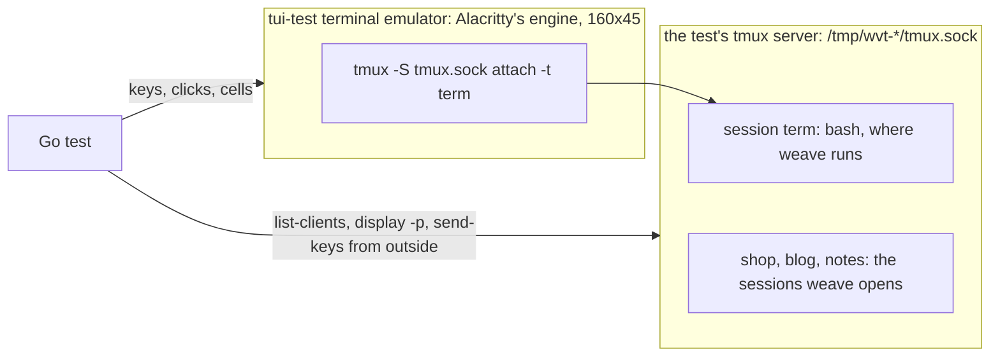

# Testing in a real terminal

How weave is checked end to end: the browser, the config form and the confirmation dialog, and how they behave together in a real terminal. The tests in [`test/terminal`](../../test/terminal) run weave in a terminal emulator attached to a tmux server of their own, type and click as a user does, and read the screen cell by cell, with its colours. CI runs them on every push and before every release.

The config form's own logic, which needs neither tmux nor a real terminal (undo and redo, the diff, a grid turned into splits, fields checked as typed, scrolling), is unit-tested instead, in [`tea_config_form_test.go`](../../internal/session/infra/tea_config_form_test.go): keys sent to its model's `Update`, its `View` read as text. A scenario here checks what that can't: attaching and switching, real sessions, settings files, clicks, colours, and a whole screen.

`test/terminal` is a Go module of its own, behind the `terminal` build tag, so weave's `go.mod`, `go test ./...` and the root lint know nothing of it. Run it from its directory:

```sh
cd test/terminal
go test -tags terminal .                          # all of them, in parallel, about 6 seconds
go test -tags terminal . -run TestRerun           # some
go test -tags terminal . -record /tmp/rec         # a GIF of each test's screen, to watch afterwards
go test -tags terminal . -shots /tmp/shots        # a PNG of the screen each test ends on
go test -tags terminal . -keep -run TestOpenGrid  # a failed test's tmux server kept, to look around
go test -tags terminal . -traces /tmp/traces      # a trace of each failed test
go test -tags terminal . -run LooksAsBefore -update  # the snapshots rewritten, to accept a change of look
golangci-lint run --build-tags terminal ./...     # the lint CI runs on it
```

A failure says what never showed, or what was found instead of what was expected, then the screen:

```text
--- FAIL: TestOpenGrid (5.41s)
    scenarios_test.go:63: the active pane is "editor", not preview
          | (the screen, less its blank lines)
```

A failure is a bug in weave only once the test's keys are known to be the right ones: run it alone, with `-keep`, and look.

A failed test's trace, with `-traces`, holds `trace.html` to open, `session.cast` to replay with `asciinema play`, and `trace.md`, what was expected and found, for an agent to read. CI keeps them as the `terminal-traces` artifact of a failed run.

## Snapshots

The `LooksAsBefore` tests, in [`snapshots_test.go`](../../test/terminal/snapshots_test.go), compare a whole screen with its text in `testdata/snapshots`: the browser on `notes` at 160x45 and at 80x24, and the config form on `notes`. Every change of look fails them: rewrite them with `-update`, and the diff of the snapshots is what to review. The test's directory shows as `/tmp/wvt-XXXXXXXX`, of the same length, so that what is aligned after it doesn't move. Keep them few, for screens worth seeing whole; check anything else with `sees` and the like.

## Before and after a release

CI runs the tests on what it builds. After a release, test what users get, each binary in turn with `-weave`:

```sh
mkdir -p /tmp/wvr/gobin && cd /tmp/wvr
GOBIN=/tmp/wvr/gobin go install github.com/medilies/weaver/cmd/weave@vX.Y.Z
gh release download vX.Y.Z -R medilies/weaver -p 'weaver_*_linux_amd64.tar.gz' -p 'weaver_*_amd64.deb' -p checksums.txt
sha256sum -c --ignore-missing checksums.txt
mkdir asset && tar -xzf weaver_*_linux_amd64.tar.gz -C asset
dpkg-deb -x weaver_*_amd64.deb deb
gobin/weave --version; asset/weave --version; deb/usr/bin/weave --version   # all vX.Y.Z
cd - && cd test/terminal
for dir in /tmp/wvr/gobin /tmp/wvr/asset /tmp/wvr/deb/usr/bin; do go test -tags terminal . -weave $dir || break; done
rm -rf /tmp/wvr
```

The tests check text, colours and what tmux holds; the emulator draws what weave sends, as a terminal would. Watch the recordings of a run with `-record` for what only eyes catch, such as a wide character cut in half.

## How it runs



- **A real terminal.** [tui-test](https://github.com/microsoft/tui-test)'s Go module runs a terminal emulator in the test, without a display: keys and clicks reach weave through a pty and tmux, as a user's do, and the screen is read as cells with their characters and colours. Mouse clicks need `mouse on`, set on the test's server. See [ADR 0004](../adr/0004-terminal-tests-drive-weave-in-a-real-terminal-emulator.md).
- **A world of its own for each test.** `start(t)` makes a directory under `/tmp/wvt-*`, not `t.TempDir()`, whose long paths can pass the 108 bytes a socket's path may have. In it: a home, the sample projects, the config, a tmux server with session `term`, and the emulator's client attached to it. Tests run in parallel, each with its own server, and `t.Cleanup` removes it all.
- **The same environment on every machine.** Every tmux command and the client run under the test's environment, not the caller's: tmux gives the panes a command creates the environment of the client sending it, so the panes would otherwise run the caller's `weave`. The `PATH` starts with the weave under test, which `start` checks `term`'s shell finds. `term` runs bash reading no rc file; the panes weave creates run bash with a home of their own, a plain prompt and no login banner. tmux's status line shows no host name or clock.
- **The binary**, built once by `TestMain` from `./cmd/weave`, or the one `-weave DIR` names.
- **Linux.** tmux, bash, and the `C.UTF-8` locale. The emulator's engine needs glibc 2.28 or musl 1.2.
- **Waiting for what must show, never for a time.** Every check waits up to 5 seconds: `sees` and `gone` for text, `eventually` for the client's session or a file, `waitRuns` for a pane's command. A redraw can match half-made: check what must and must not show on one capture, with `screenShows`. Only a program just started needs waiting for, until its key line shows.

## Never touch the user's tmux

The agent's shell usually runs inside the user's tmux, with `$TMUX` set, and `tmux` then talks to the user's server whatever `TMUX_TMPDIR` says. The harness names its socket in every tmux command and passes no `TMUX`. Driving a kept server by hand, do the same:

- Start every command with `unset TMUX`, and never run a bare `tmux`: `tmux -S /tmp/wvt-…/tmux.sock …`, the path `-keep` logs.
- Before relying on an empty value, such as a pane ID, check it: `send-keys -t ""` goes to whatever tmux picks.

## Scenarios

Each is a test, in [`scenarios_test.go`](../../test/terminal/scenarios_test.go), [`form_test.go`](../../test/terminal/form_test.go) for the config form, or [`snapshots_test.go`](../../test/terminal/snapshots_test.go) for whole screens, named for what it checks, with a comment above it saying what it does, then what it expects. List them, each with how it starts, with `grep -h '^// Test' test/terminal/*_test.go`. Their comments use a shorthand: *started* means started with `weave <project> --detached` from `term`; *select* means with the filter; *edit* means `e` on the project, selected in `weave`; *from outside* means a tmux command the test sends, not keys a user types.

## Sample projects

[`testdata/projects`](../../test/terminal/testdata/projects) holds them, `ROOT` standing for the test's directory. Each is there for some cases:

- `shop`: window `env`, `focus`, setup and teardown commands (one of them failing), tasks, and a command that exits.
- `blog`: a grid window whose focused pane isn't the first.
- `notes`: a grid with a column in cells, beside a second window, to check cell sizes, miniatures, settings, the config form's snapshot, and tasks of two panes in one window.

## Adding scenarios

The list grows. Add a scenario whenever a case it misses turns up: a new feature or a changed behaviour, a bug found by hand, by a review or by a user, or anything a run shows that no test checks. Add a test as [Scenarios](#scenarios) says, and what its sample needs to `testdata/projects`. In the test:

- Start with `h := start(t)`, and set up the rest: `h.started("shop")`, `h.logsIdle()`, `h.settings(…)`.
- Act as a user: `h.keys`, `h.types`, `h.typed`, `h.clicks`. Act from outside with `h.tmux`.
- Wait for what must show (`sees`, `gone`, `eventually`, `waitRuns`, `screenShows`), never `time.Sleep`.
- Fail with what was found instead of what was expected: `h.fatal` adds the screen.
- Check what tmux holds and what is written, not only the screen: `h.tmux("display", "-p", …)`, `h.paneOf`, `h.config("shop")`.
- Run it at least 10 times, `-count=10`, before trusting it: a check that passes once can still race.

This file and the tests are public, in the repository. Keep everything in them generic:

- Paths only under the test's directory, or as `~` and tools found on `PATH`. Never a real home directory, user name, user ID, host name or install path.
- Sample projects and commands made up for the test (`shop`, `blog`, `sleep`, `echo`), never the user's own projects, configs, sessions or their names.
- Expected output as weave prints it for the samples, never copied from the user's terminal with their prompt, paths or other sessions in it.
