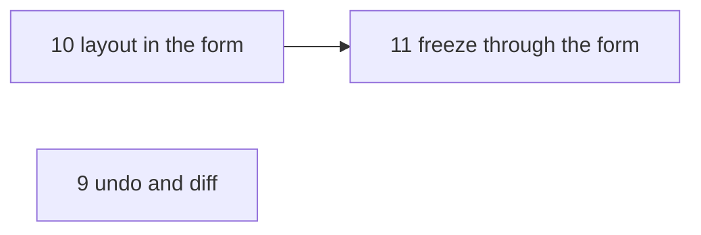

# weaver backlog

Everything left to do or decide, in the order to do it: the browser
ideas, the config ideas and what is left of the quality report (review
of 2026-11-06, revised 2026-11-07), merged on 2026-11-08. Their history
is in `git log -- docs/ideas.md docs/config-ideas.md
docs/quality-report.md`.

## How the order is chosen

From the project rules in `CLAUDE.md`:

- **Finish what exists before adding.** Test gaps come first; a
  deferred finding goes with the task it waits for.
- **Show what the config already says before adding to it.** The
  browser can draw far more than it does, with no change to `domain` or
  `app`.
- **Domain before forms.** Rules go into `domain` before a form or the
  browser needs them; the forms only collect answers.
- **Config fields only when a config needs them.** A field no config
  uses yet waits in [By need](#by-need), with what would call for it.
- **weaver runs only what a config says, and knows nothing of git.**
  Ideas that act on the user's behalf, or need git, are
  [Parked](#parked).
- **Words first.** A new concept gets a glossary entry in `CLAUDE.md`
  before it gets code.

Sizes: XS (a line or two), S (up to about 30 lines plus a test, in one
or two layers), M (up to a few hundred lines, or several layers), L (all
layers), XL (mostly open questions).

## Order

| # | Task | Kind | Size | Needs |
| --- | --- | --- | --- | --- |
| 9 | Undo and the diff before saving | form | S | |
| 10 | The layout in the config form | form | M | |
| 11 | Freeze through the config form | form | M | 10 |



## 9. Undo and the diff before saving

The config form (`infra/tea_config_form.go`, `weave edit`, key `e`)
changes a project in place, but a deleted pane or window can only come
back by leaving without saving.

- **Undo is cheap**: projects are immutable values, so undo is a stack
  of earlier `Project`s in the form's model, `u` popping it and
  `ctrl+r` redoing.
- **The diff**: `ctrl+s` can show what saving changes, the stored
  config against `encodeProject`'s, before writing. Comments the user
  wrote show as removed, which the warning before the form opens only
  says in a sentence.

## 10. The layout in the config form

A window's card becomes the browser's drawing, edited with tmux's own keys: `%`
splits the selected pane right, `"` below, `x` removes it, arrows
select, `H/L` resize. The selected pane's fields show below.
`split: {of, direction, size}` is never seen.

```text
 [ api ]  app  repo  + window
┌─ api shell ──────────────────┬─ task dev ──────────┐
│ api/                         │ api/                │
│ $ █                          │ $ task dev          │
│                              │                     │
│                              ┢━ psql ━━━━━━━━━━━━━━┪
│                              ┃ $ nimbus psql       ┃
│                              ┃                     ┃
└──────────────────────────────┺━━━━━━━━━━━━━━━━━━━━━┛
 psql  splits task dev ↓ half
 % split right · " split below · x remove · ←→↑↓ select · H/L resize
```

A window with a `grid` is edited as a grid, never saved back as
splits: `Window.Grid()` gives it, and `encodeProject` writes it.
Turning a grid window into splits, or back, is an action of its own,
never a side effect. Saving a grid window lists its panes in creation
order, not as the config listed them; keep the config's order here if
the form makes that visible.

## 11. Freeze through the config form

Freeze opens the config form on its draft (name, root and the captured
windows, if any), and the freeze forms in `infra/huh_forms.go` go, with
the form rules left in them. Freezing and changing a project then share
one form. The config form keeps the draft's name, as editing needs:
freezing needs it typed, checked with `NewProjectName`, and the draft
saying which.

## By need

Each waits for a config or a user that needs it; the trigger says what
that looks like. They are listed from the smallest.

### The config in the browser (XS)

**When**: someone misses the config's YAML in the details pane, which
the drawing replaced. `E` opens the file, and a config that can't be
read shows why. Bring it back behind a key (`y`):
`ProjectOverview.Config()` still carries it.

### Grid sizes in cells (S)

**When**: a config wants a fixed-width column or row beside ones that
share the rest, such as a 30-cell file tree.

A grid's `columns` and `rows` take `%` and `fr` only: a split's `-l`
is the new pane's size, so a cell size on a leading track depends on
the window's width. Either size the split from the terminal's size
(`TmuxOptions.Size`), split with `-b` so the new pane is the fixed one,
or apply a `select-layout` string with tmux's checksum. Freeze would
still write splits; writing a grid when a session fits a small one is
its own decision.

### Window miniatures (S)

**When**: projects with many windows, and a details pane tall enough
to spare the lines.

The tabs above the drawing become small drawings of every window, the
selected one highlighted:

```text
 api              app              repo
┌──────┬────┐    ┌──────┬────┐    ┌───────────┐
│      │    │    │      │    │    │           │
│      ├────┤    │      ├────┤    │           │
└──────┴────┘    └──────┴────┘    └───────────┘
```

`drawing` already draws at any size; this is `tabs` calling it small.

### Window `env` (S)

**When**: a config sets the same variable in every pane of a window.

```yaml
windows:
  - name: api
    env: { APP_ENV: local }
```

`before` already applies at three levels; `env` skips the window. Each
variable is set by the project, then the window, then the pane, the last
one winning.

- `domain`: `Window` gets an `env` and a `WithEnv`. `planPane`
  (`domain/plan.go`) becomes
  `p.env.Overlay(window.env).Overlay(pane.env)`.
- `infra`: `windowFile.Env`, `windowFileOf`, and
  `$ref: "#/definitions/env"` in the window's schema.
- Test: a window's variable overrides the project's, and a pane's
  overrides the window's.
- The browser's levels and the config form show the extra level once
  it exists.

### Focus (S)

**When**: the pane you work in isn't the first one created, such as a
wide editor split off a narrow log pane.

```yaml
windows:
  - name: shell
  - name: editor
    focus: true
    panes:
      - name: logs
      - name: nvim
        split: { direction: right, size: 70% }
        focus: true
```

Windows and splits are created with `-d` (`Tmux.newWindow`, `Tmux.fill`),
so you always land in the first window's first pane. That stays the
default. tmuxinator has it as `startup_window` and `startup_pane`, tmuxp
as `focus: true`.

- `domain`: at most one focused window per project and one focused pane
  per window, checked in `WithWindows` and `NewWindow` (two new errors).
  The plans carry the choice.
- `infra`: `Tmux.Start` ends with a `select-pane` per window and one
  `select-window`. `Tmux.Restore` selects the focused pane in the
  windows it adds, without switching away from the window you're in.
- Freeze reads `#{window_active}` and `#{pane_active}` in `Capture`, so
  a captured session keeps where you were.
- Schema: `focus` boolean on windows and panes.
- Test (tmux): after `Start`, the focused window and pane are active.

### Start and teardown commands (M)

**When**: a project starts something outside its panes: containers
started with `-d`, daemons, ssh tunnels. `weave kill` runs tmux's
`kill-session` (`Tmux.Kill`); the shells get SIGHUP, but anything that
left the pane keeps running, so every kill leaks it. No config starts
anything outside its panes yet, which is why this waits.

**Words first**: the glossary rules out "stop", and these are commands
run before a kill, a new concept rather than another word for kill.
Name it (and its config key) and give it a glossary entry before any
code. `start` is free.

```yaml
start:
  - docker compose up -d
<teardown key>:
  - docker compose down
```

`start` commands run in `root`, in order, once, when `weave <project>`
creates the session. Teardown commands run in `root`, in order, before
`weave kill` kills it. smug has `before_start` and `stop`, tmuxinator
`on_project_first_start` and `on_project_stop`.

A pane's `command` can do `start`'s job, but worse: it runs at the same
time as the other panes, so they can't count on it; when it fails, the
session still opens, half-working; it runs again each time restoring
re-creates its window, and it takes up a pane. `start` runs before
anything is built, like the directory checks, so a failure leaves no
session behind.

- `domain`: `Project.Start()` and a teardown getter, lists of `Command`.
  A new port runs a command in a directory with an env
  (`CommandRunner`); `infra` implements it with `sh -c`, output to the
  terminal. Both lists use it.
- `before` commands don't apply to either list. They are typed into
  interactive shells (`nvm use` is a shell function), while these run in
  `sh`. The project's `env` does apply. Say so in the schema.
- `start`, in `app`: `OpenProject.start` runs the commands before
  `checkDirs`, so a `start` command can create a pane's directory, and
  before `sessions.Start`. A failing command stops the open, and nothing
  is built. Restoring windows and attaching don't run `start`.
- Teardown, in `app`: `KillProject` holds a `SessionKiller` and a
  `SessionLocator` today; it would also load the project from the
  `ProjectRegistry`. When the config can't be read, kill anyway, as now:
  you asked to kill it. When a teardown command fails, still kill the
  session and report the failure.
- Browser: `enter` and `x` run their use case after the Bubble Tea
  program exits (`BrowseProjects.act`), so the output reaches the
  terminal. A failure returns to the browser as its notice, and the
  redraw hides the output: the error has to carry the command's last
  lines of stderr itself.
- The warnings check that `start` and teardown programs are on `PATH`,
  as they do for pane commands.
- Freeze can't see either list: replacing a config drops them, as it
  drops comments. Once #11 is done, freeze through the config form can keep
  them from the existing config.
- `d` deletes the config but keeps the session running, so no teardown
  there.
- Second step, optional: send Ctrl-C to every pane and wait, with a
  timeout, until its shell is idle (`foreground`), so dev servers shut
  down cleanly before the kill.

### Secrets read at start (M)

**When**: a config would hold a secret.

```yaml
env:
  APP_ENV: local
  DB_PASSWORD: { from: pass show shop/db }
```

`env` values are literal, so a secret ends up in plain YAML, likely in a
dotfiles repo. `from` runs a command the config names and uses its
output.

- Where the command runs matters more than how it is parsed. In the
  pane's startup script (`shellCommand`, `infra/tmux_script.go`), as
  `DB_PASSWORD="$(pass show shop/db)" || printf …; export DB_PASSWORD`.
  The value then never passes through weaver, tmux's arguments or `ps`;
  only the command does. Resolving it in weaver and exporting the value
  would put it in the `sh -c` argument, visible in `ps` and in
  `#{pane_start_command}`.
- What that costs: the command runs once per pane (`pass` and `op`
  cache their unlock, so usually fine), and a failure leaves the
  variable empty and prints a warning in the pane instead of stopping
  the open.
- `domain`: an `EnvVar` is either literal or from a command; `Overlay`
  doesn't change.
- `infra`: a value decodes as a string or `{from: …}` (a custom
  `UnmarshalYAML`), and the schema uses `oneOf`.
- The browser summary and `weave show` print
  `DB_PASSWORD from pass show shop/db`. weaver never has the value to
  print.
- The warnings can check that the `from` program is on `PATH`.

### Is it still running? (M, then M)

**When**: "is my dev server still up?" comes up often enough to want an
answer without attaching. Two answers, cheapest first; the first may be
enough.

**Warn when a pane's command exited.** No config. In the browser
summary, and on its pane, as a `Warning` concerning it:

```text
 ⚠ api › task dev: back at the prompt, its command exited
```

weaver knows which panes it typed a command into (`Startup.Submits()`).
In an owned session, such a pane whose shell is idle again means the
server crashed or was interrupted.

- `infra`: `foreground(pid)` already tells whether a pane's shell is
  idle; freeze uses it. A new tmux method lists a session's panes with
  their window tag (`@weaver_window`), label (`@label`) and pid.
- That listing also fixes `Capture`'s four or five `display-message`
  calls per pane, where one `list-panes -F` would do. Not worth changing
  on its own: freeze is interactive, and splitting free-text paths and
  labels out of one line of output adds parsing risk. Keep `foreground`
  meaning "the shell is idle": this and the clean shutdown above rely on
  it.
- `domain`: a method on a session port (`SessionFinder` or a new one)
  returning, per window, the panes whose shell is idle.
- `app`: `ProjectOverview` gets the panes whose command exited. Only
  panes with a `command`, not `prefill` or a plain shell, and only in
  owned sessions.
- Don't compare the command line: `ps` loses quotes, pipes and
  variables (see `Capture`). A shell idle when it should be running
  something is enough.
- Caveat: a command interrupted on purpose (Ctrl-C) warns too. It is a
  hint, not an error.
- Later: a browser key that types the pane's command again.

**Live preview.** Like tmux's `choose-tree` preview: `capture-pane` each
pane of a running session and fill the drawing's boxes with their last lines,
drawn from tmux's real geometry instead of the plan, so panes closed or
added show against the config. `infra/tmux_layout.go` already parses
`#{window_layout}` for freeze, so the geometry costs almost nothing;
what is left is `capture-pane` on the tmux port and a refresh while the
browser is open. The refresh loop is when to build the overviews
concurrently: the browser rebuilds every overview, one after another,
before each view, which is fast while they only check directories and
programs.

### `wait` (M)

**When**: a pane's command must run only once something answers: the
front end after the API, the migrations after Postgres. Comes after
start commands, which cover setup that must finish before the panes
open; `wait` orders the panes among themselves.

```yaml
      - name: front
        dir: front
        wait: { port: 8000 }               # localhost:8000 accepts connections
        command: npm run dev
      - name: migrate
        dir: back
        wait: { port: 5432, timeout: 60s }
        command: php artisan migrate
```

- weaver exits once it attaches, so it can't do the waiting. The pane
  has to.
- A hidden subcommand, `weave wait tcp localhost:8000 --timeout 60s`,
  typed as `<weave> wait … && npm run dev`, with weave's absolute path
  (`os.Executable`). It needs no `nc` or `curl`, works in any shell,
  shows what it waits for, and Ctrl-C skips it. The alternative, waiting
  in the startup script, keeps the history clean, but the keys weaver
  types meanwhile echo on screen until the shell reads them.
- `domain`: `Pane.Waiting(…)`, kept apart from the command, so that
  `Command.Program()` and the warnings still see `npm`, not `weave`.
  Only with a `command` at first: waiting before a `prefill` relies on
  type-ahead, which is uncertain.
- Start with `port` (host default `localhost`) and `timeout`; `http` (a
  2xx answer) if needed later.
- Freeze can't see waits: replacing a config drops them, as it drops
  comments.
- A new subcommand reserves its name (`reservedNames` in
  `domain/project.go`), which breaks a registered project already named
  `wait`. Released configs may be, so decide how: a migration message,
  or no new subcommand.

### Lazy windows and tasks (L, L)

**When**: a project has heavy windows you don't always want (an
emulator, a log tail), or one-off commands you run often in a given dir
(migrations, seeds, deploys). Both want a second argument to `weave`,
which takes at most one today (`cmd/weave/root.go`), so design the two
syntaxes together, even if only one gets built. `weave run` is a new
subcommand, which reserves `run` as a project name, as `wait` would.

**Lazy windows.**

```yaml
windows:
  - name: app
  - name: emulator
    lazy: true
    panes:
      - prefill: nimbus emulator
```

A lazy window is in the config, but `weave nimbus` doesn't create it;
`weave nimbus emulator` (the window completed from the config), or the
browser, does.

- `domain`: `Window.Lazy()`. `Plan()` leaves lazy windows out, and
  `Restoration` doesn't bring back a missing lazy window. Opening one on
  request uses the same placement rule (after the window listed before
  it), so split that logic out of `Restoration` into a placement for one
  window. At least one window must not be lazy.
- `app`: a new use case, `OpenWindow`. It starts the session without
  its lazy windows if needed, adds the window, then attaches with it
  selected.
- Browser: lazy windows marked in the tabs (`emulator · lazy`), and a
  key with a small picker to open one (a new `Action`).
- The warnings check a lazy window only when it is being opened.
- Freeze from a session where the window isn't open drops it from the
  config it writes: warn, or carry lazy windows over from the existing
  config.

**Tasks.**

```yaml
tasks:
  migrate:
    dir: back
    command: php artisan migrate
```

Named one-off commands, run with `weave run shop migrate` or from the
browser, in the right `dir`, with the project's `env` and `before`.

- Inside tmux, in a popup (`display-popup -E -d <dir>`) that stays open
  on exit to show the result. Outside tmux, in the current terminal.
- `before` commands are often shell functions (`nvm use`), so run
  `$SHELL -ic '<before>; <command>'`, not `sh -c`. Startup is slower (rc
  files are read), and `-i` behaves differently from one shell to
  another.
- `domain`: `Task` (name, dir, env, before, command), close to a pane
  without a split, reusing its value objects. `Project.Tasks()`.
- `app`: a `RunTask` use case, and a port to run it in a popup or the
  terminal.
- CLI: `weave run <project> <task>`, both completed, and
  `weave run . migrate`.
- Browser: tasks listed in the summary; `t` to pick one and run it. The
  warnings check task programs too.
- Schema: `tasks` maps a name to a task object.

## Parked

Against the project's rules as they stand. Each says what would have to
change to bring it back.

- **Most recently opened first, in the list.** weaver would keep a
  record of when each project was opened, besides the configs. Back if
  the list grows long enough that the filter isn't enough.
- **`history`**: put a pane's usual commands in its shell history, so ↑
  brings them back. weaver would type into the shell's history and leave
  lines piling up in `$HISTFILE` (bash and zsh save it on exit), which
  the user never wrote as commands to run, and each shell needs its own
  syntax (bash `history -s`, zsh `print -s`, fish neither). `note`
  already shows them, and tasks run them. Back if `note` and tasks prove
  not enough; the shell details (`ignorespace`, `HIST_IGNORE_SPACE`,
  `erasedups`, ordering) are in `docs/config-ideas.md` in the history.
- **Hooks beyond start and teardown.** A general hook mechanism is an
  abstraction with one user so far. Start and teardown commands are the
  first two hooks; a third need is when to design the general shape
  (one `hooks:` key or top-level keys, what weaver hands a hook as
  environment variables, such as `WEAVER_PROJECT` and `WEAVER_ROOT`).
  *hook* needs a glossary entry first.
- **A git plugin.** weaver knows nothing of git (`5e8f663`, `0355ed1`,
  then `repositories:` removed). Cloning missing repositories can come
  back only as a separate program, such as `weaver-git`, named in a
  config's start commands (`weaver-git clone`), keeping its own list of
  repositories. Showing a branch needs another hook: a command whose
  output is a line of the browser's summary, with a time limit, since
  start commands run once with output to the terminal. It isn't
  part of `weave`; plugins found on `PATH` as git finds `git-foo` would
  add dispatch code to the core. *plugin* needs a glossary entry first.
- **Worktree variants** (`weave shop@fix-123`: the shop layout on a
  branch, beside the main session). Mostly git, so only through the git
  plugin. Open questions: which repositories get the branch; per-variant
  ports (a `WEAVER_VARIANT` variable, or `env` overrides per variant);
  `@` in names (free in project names, check tmux `-t` targets, and the
  `@weaver_project` tag and `Find`'s check of who started the session
  must include the variant); removing worktrees with uncommitted
  changes. A root that holds no repository can't have variants.

## Left and ignored

Not worth the code, or out of scope. Kept so they aren't reported again.

**Ignored** until a user needs it:

- **macOS.** `os.UserConfigDir()` returns `~/Library/Application
  Support` there and ignores `XDG_CONFIG_HOME`, so the help text
  (`cmd/weave/root.go`) and README promise the wrong location. Either
  document the macOS path, or resolve `$XDG_CONFIG_HOME` (falling back
  to `~/.config`) on every OS, which moves existing macOS configs and
  would have to keep reading the old directory. On a case-insensitive
  filesystem, freezing `shop` when `Shop.yml` exists overwrites it
  without the replace prompt (the TODO in `domain/project.go`). CI
  builds only for Linux, though darwin binaries ship.
- **Any tmux but 3.4.** CI and releases run on ubuntu-24.04 for Ubuntu's
  tmux 3.4, not ubuntu-latest; re-pin when GitHub retires that runner.
  Another version may differ in what weaver reads back: 3.4 prints a `\`
  before some `$` (see `verbatim` in `infra/tmux.go`). Older than 3.2
  fails for sure: restoration needs `new-window -b`.

**Left**:

- **A tmux version check when weave runs.** Follows from the above.
- **Schema stricter than the code.** `ParseSize` uses `strconv.Atoi`, so
  it accepts `+5`, `040` and ` 40% `, which the schema rejects;
  `ParseDirection` and the root accept surrounding whitespace. That is
  the safe way round: the editor warns, and weave still loads the
  config. Tightening the parsers could reject released configs that load
  today, and every other value object trims its input (`oneLine`).
- **`weave edit` races.** Edits are lost if the config is deleted while
  the editor is open (`ErrProjectNotFound`), and nothing protects
  against a lost update from a concurrent `weave freeze`.
- **Config file names that differ only by spaces.** `shop .yml` lists as
  `shop`, because `NewProjectName` trims; `FindByName` then reads
  `shop.yml`, and with both files present `Names()` lists `shop` twice.
  The fix would skip, with a warning, any file whose stem isn't exactly
  the name.
- **Freezing a pane with a job.** It is frozen in its shell's directory,
  read from `/proc`, so `make -C sub dev` from the root keeps the root.
  A subshell that changes directory first loses it:
  `(cd api && exec sleep 300)` is frozen with the root and the prefill
  `sleep 300`. A shell a wrapper forks, as a `default-command` of
  `sh -c 'bash -i; true'` does, is taken for a job. Telling shells apart
  would be guesswork.
- **Freezing a pane started as another shell.** `tmux new-window zsh`
  where `default-shell` is bash is frozen with `zsh` typed at its
  prompt, for the same reason.
- **A symlink in a root that leads out of it.** `/srv/shop/api` to
  `/data/api` is frozen as the absolute `/data/api`: tmux and `/proc`
  report directories resolved. Editing the config keeps the link.
- **GoReleaser's version format.** It stamps `{{.Version}}` (`0.2.0`),
  while `go install …@v0.2.0` reports `v0.2.0`. Stamping `{{.Tag}}`
  gives one form, and `TestReleaseBuildsReportTheStampedVersion` would
  expect `v0.2.0`.
- **The changelog filters.** `^docs:`, `^test:` and `^chore:` miss
  scoped and other types, so `build(deps): …`, `ci: …` and merge commits
  reach the release notes. If they should go:
  `^(docs|test|chore|ci|build)(\(.+\))?!?:` plus `^Merge`.
- **Where `requireTool` lives**: in `local_workspace_test.go`, though
  the tmux tests use it too.

**Left out** of the config, as other session managers have them:

- `layout` presets (`tiled`, `main-vertical`): splits already describe
  more, and a grid writes them out explicitly.
- A flex layout (nested rows and columns of sized panes): it is
  `#{window_layout}`'s tree, saying what splits already say, more deeply
  nested. `wrap`, `gap`, `justify-content` and `align-items` mean
  nothing to tmux, whose panes always fill the window, so the name
  promises more than it can do. A grid is the other notation.
- `synchronize-panes`, a raw tmux `options` field: rarely needed.
- `sleep` delays (tmuxp's `sleep_before`): `wait` does the same job more
  reliably.
- Templates and variables passed when opening (tmuxinator's ERB
  `key=value`, smug's `-v`): there is one config per project, and `env`
  covers the rest.
- A config committed inside the repository (`.tmuxp.yaml`,
  `.laio.yaml`): it breaks "one file per project in the config folder",
  and only pays off when a team shares it.
- Saving pane contents to bring back after a reboot (tmux-resurrect):
  weaver rebuilds from the config, which is the better source of truth.
- Opening some windows from the command line (smug's `proj:win1,win2`):
  restoring brings back closed windows, and lazy windows put the choice
  in the config.

## Shared groundwork

- The drawing's geometry (`layOut` in `infra/tea_drawing.go`) serves
  #10, and its border drawing the live preview.
- The domain's methods changing panes and windows, and the config
  form's cards, serve #10 and #11.
- `CommandRunner` serves start and teardown commands, and any later
  hook.
- The idle-shell check (`foreground`) serves the exited-command warning
  and the clean shutdown after teardown.
- One tmux pane listing serves the exited-command warning and
  `Capture`.
- A second CLI argument serves lazy windows and tasks: design both
  together.
- The `sh` startup script (`shellCommand`) carries secrets, and maybe
  `wait`.
