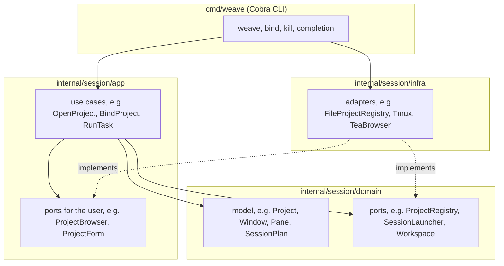

# Development

```sh
go build ./...               # build everything
go run ./cmd/weave X         # run without building
go test ./...                # run tests (the tmux adapter's need tmux)
golangci-lint run ./...      # format check, static analysis, layer boundaries

cd test/terminal
go test -tags terminal .                    # weave in a real terminal emulator
golangci-lint run --build-tags terminal ./...
```

Tests that need tmux start private tmux servers on their own sockets;
they never touch your sessions. The terminal tests are described in
[docs/agents/terminal-testing.md](agents/terminal-testing.md).

## Architecture

Use cases depend on ports; `infra` implements them and `cmd/weave`
wires everything together. The layer rules are in
[CLAUDE.md](../CLAUDE.md#design). The types below are examples, not a
full list.



## Releasing

Pushing a `vX.Y.Z` tag runs the tests, then GoReleaser builds the
binaries and a `.deb`, and the apt repository on GitHub Pages is rebuilt,
signed with the key in the `APT_SIGNING_KEY` secret. Then run the
terminal tests on the published binaries, as
[terminal-testing.md](agents/terminal-testing.md#before-and-after-a-release) says.
