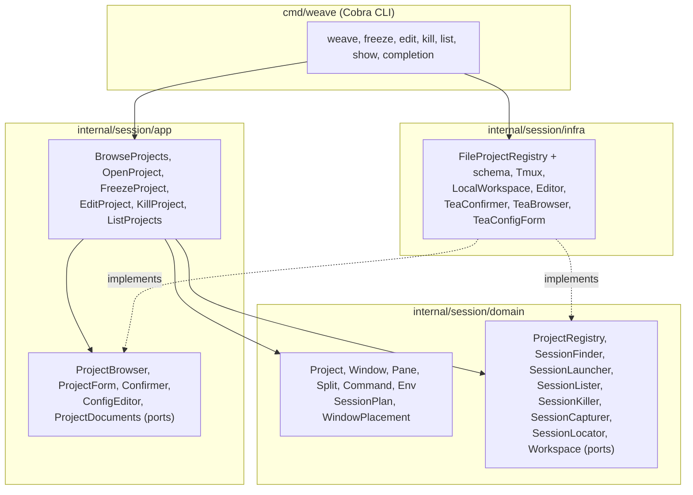

# Development

```sh
go build ./...               # build everything
go run ./cmd/weave show X    # run without building
go test ./...                # run tests (the tmux adapter's need tmux)
golangci-lint run ./...      # format check, static analysis, layer boundaries
```

The tmux adapter's tests start private tmux servers on their own
sockets; they never touch your sessions.

## Architecture

The `Session` bounded context is organized by layer. `domain` imports
only the standard library, and `app` only that and `domain`, which
depguard allow-lists in `.golangci.yml` enforce. Use cases depend on ports; `infra`
implements them and `cmd/weave` wires everything together.



Agent workflows, such as testing weave in a real terminal, are in
[docs/agents/](agents/).
