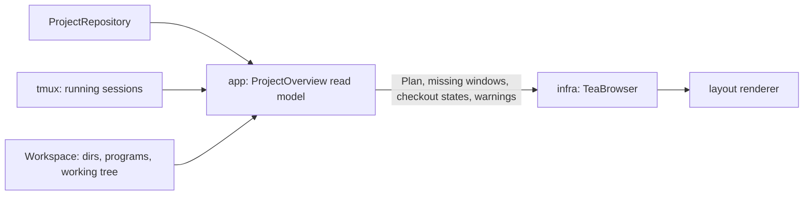

# Browser details pane: ideas

The browser's details pane shows the selected project's summary (root,
checkouts, working tree, session comparison, warnings), then its raw
YAML (`infra/tea_browser.go`, `details()`). The YAML says little at a
glance, and `e` already opens the file. The domain knows much more than
the file shows: splits with direction and size, startup commands and
notes. These ideas use that knowledge instead.

## 1. Draw the layout ⭐

Draw each window's panes as boxes in their real proportions, built from
`Project.Plan()`. Each box shows the pane's name, its directory when it
isn't the root, and its command. `←/→` moves between windows.

```
 shop  ● running                 ~/dev/shop
 ─────────────────────────────────────────────
 [ editor ]  server   logs              1/3
 ┌──────────────────────┬───────────────┐
 │ nvim                 │ back/         │
 │                      │ make watch    │
 │                      ├───────────────┤
 │                      │ git status ▸  │  ▸ = prefilled, not run
 └──────────────────────┴───────────────┘
```

A layout is the hardest part of a config to picture from YAML
(`split: {of: 1, direction: below, size: 30%}`).

**Notes**

- The data is all there: `ProjectOverview.Project().Plan()` gives each
  pane its `Split()` (`Of`, `Direction`, `Size`), `Dir()` and `Startup()`
  (its command, and `Submits()` for run or prefilled). No new port, no
  change to `domain` or `app`.
- The geometry is pure: start from one rectangle; each later pane cuts
  the rectangle of the pane it splits (`Right` into columns, `Below` into
  rows) and takes `Size` of it, half by default. That is tmux's own
  model, so no tree needs rebuilding. It can live in `infra` beside the
  browser and be unit-tested as a function from a `WindowPlan` and a size
  to rectangles, even though the browser itself isn't tested.
- Borders are the bulk of the work. Draw each rectangle's edges into a
  rune grid as direction bits (up, down, left, right), then map each
  cell's bits to its box character: the junctions (`├ ┤ ┬ ┴ ┼`) come out
  right with no special cases.
- Sizes in cells (`size: 20`): the drawing is smaller than the real
  terminal, so scale them against an assumed window, say 200×50.
- Small boxes: truncate labels to fit. Small terminals: below a minimum
  size, fall back to a list of panes.
- `←/→` is one more index in the `browser` model and two cases in
  `press`; neither key is taken yet. Reset it when the cursor moves to
  another project.
- Check the drawing by hand in a throwaway tmux server, like the rest of
  the browser.

**Effort**: one commit, roughly 150–250 lines plus geometry tests. The
risk is in drawing the borders, not in the design.

## 2. Live preview of a running session

Like tmux's `choose-tree` preview: `capture-pane` the active pane of a
running session and show its last lines. Answers "is my dev server still
up?" without attaching. Needs a new method on the tmux port, and a
refresh while the browser is open.

## 3. Better list

- `/` filters the list as you type
- Most recently opened projects first (needs to record when a project
  was opened)
- The root path, dimmed, beside each name

## What happens to the YAML

Drop it: `e` opens the file. When a config can't be read, the details
pane already shows why. If it turns out to be missed, bring it back
behind a toggle (`y`).

## Suggested order

The `ProjectOverview` read model already carries checkout states, root
existence, the working tree, the session comparison and the warnings;
the browser only draws them.

1. **#1**: the layout renderer, from `Project.Plan()`. Then drop the YAML
   (see above).
2. **#3**: the better list.
3. **#2** last: it adds a polling loop and a new tmux call, the largest
   change for the least certain gain.


